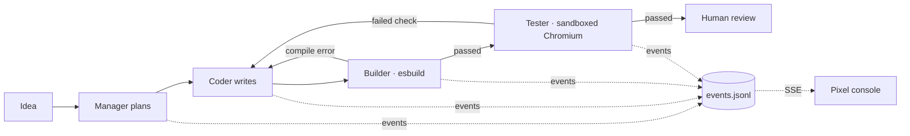

# PixelAgent Hub · Pixel AI Dev Squad

[中文](README.md) · English

[](https://github.com/3617375681/PIXELAGENT-HUB/actions/workflows/ci.yml)
[](https://github.com/3617375681/PIXELAGENT-HUB/actions/workflows/pages.yml)
[](pixelagent-hub/LICENSE)

**Type an idea, watch 4 agents build it.** The Manager plans, the Coder writes a small offline web app, the Builder really compiles it with esbuild, and the Tester clicks through it in a sandboxed Chromium. Any compiler error or failed check goes straight back to the Coder. Every animation in the pixel console is driven by a recorded server event.

**▶ [Try it](https://3617375681.github.io/PIXELAGENT-HUB/)**: watch 40 recorded real-model runs, or press **BUILD LIVE**, paste your own DeepSeek key, and the four agents build your idea right in your browser (no backend) · [Run locally](#run-locally) · [Evidence index](pixelagent-hub/docs/evidence/README.md)


| **30** real-model generations | **13/15 vs 12/15** no measurable multi-agent advantage | **0** simulated animations |
| :---: | :---: | :---: |
| each with source, event log and browser report | plan-then-code vs code-only, published as measured | every animation maps to a server event |

## PLAY LIVE: build in your browser

The online page has no backend. BUILD LIVE runs the whole Manager → Coder → Builder → Tester loop in your tab: model calls go straight from your browser to `api.deepseek.com` with your key, esbuild-wasm compiles the code, and the Tester's checks run one by one in a sandboxed iframe. It uses the **same** prompts, output validation and bundling as the local server (`src/studio/shared`) and emits the same events, so the squad, sounds and red repair edge behave identically.

- A small calculator takes about 20 s with `deepseek-chat`; a run is typically 20k–40k tokens.
- Your key stays in the tab by default; generated apps run in an iframe without same-origin access and cannot read it. See [SECURITY.md](pixelagent-hub/SECURITY.md).
- Limitation: in-browser checks run inside the app's own page, so a hostile app could forge them. Independent sandboxed-Chromium checks need the local server.

## Results you can check

All with `deepseek-v4-pro`; every run keeps its source ZIP, test plan, browser report and screenshots.

- **[Single vs multi-agent, repeated](pixelagent-hub/docs/software-studio/benchmark-results/2026-10-15-repeated/README.md):** 5 apps × 2 strategies × 3 runs. Manager → Coder passed every check in 13/15 runs, Coder only in 12/15. Planning cost ~1,200 extra tokens per app and bought no measurable improvement. Every failure (a quiz whose score never changed, two converters that ignored a "text input" requirement, two timeouts) is listed.
- **[Controlled fault repair](pixelagent-hub/docs/software-studio/benchmark-results/2026-10-09-real-repair-source-context/README.md):** a counter changed to `+= 2` failed 2/4 browser checks; repair from that evidence changed one line, left three files byte-identical, and passed 4/4 plus 7/7 extra checks.
- Small samples, not general success rates.

## How it works



- **Backend:** TypeScript + Node. `src/studio` runs the generate → build → check loop in an isolated per-project workspace, persists state as atomically written JSON, appends every transition to an ordered event log and streams it over SSE. The HTTP contract ([studio-api.yaml](pixelagent-hub/openapi/studio-api.yaml)) is validated against real responses in tests.
- **Frontend:** React 19 + Vite. A pure reducer turns events into the four agents' state, connectors, data packets and the red feedback edge. No fake progress.
- **Engineering:** queueing, cancellation and timeouts, restart recovery, idempotent creation, auth and rate limits. CI covers Node 18/20/22, Windows, a real browser and a Docker production start.

## Run locally

Needs Node 22.12+. The default offline mock model builds a real pixel counter whose first attempt deliberately fails to compile, so you see the real compile → repair loop without an API key.

```bash
cd pixelagent-hub
cp .env.example .env          # LLM_PROVIDER=mock; set a real provider + key for real generation
npm ci && npm --prefix dashboard ci
npm run build:all
npm start                     # http://127.0.0.1:3100/studio
```

Browser checks: `npx playwright install chromium` and `ENABLE_STUDIO_BROWSER_CHECKS=true`. Docker: `docker compose up --build` from the repo root.

## Limits

- Generates small offline HTML/CSS/JS apps and games only: no databases, logins, payments or npm dependencies.
- Tester checks are model-written and cover only what the plan lists; passing them is not human acceptance.
- Single process, not a distributed scheduler.

## How it was built

The starting point was a pixel-art multi-agent console prototype generated by Kimi (fake data, commit `14a030e`). The backend and Studio loop were built with GPT's help; Claude Code then narrowed the scope, restored the original look, and added the event timeline and static replay. The author set the direction, trade-offs and acceptance criteria; every change goes through tests and CI.

MIT licensed — see [LICENSE](pixelagent-hub/LICENSE).
