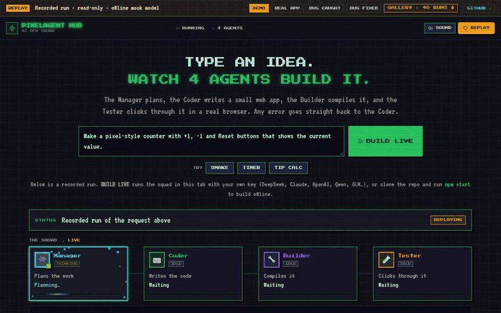
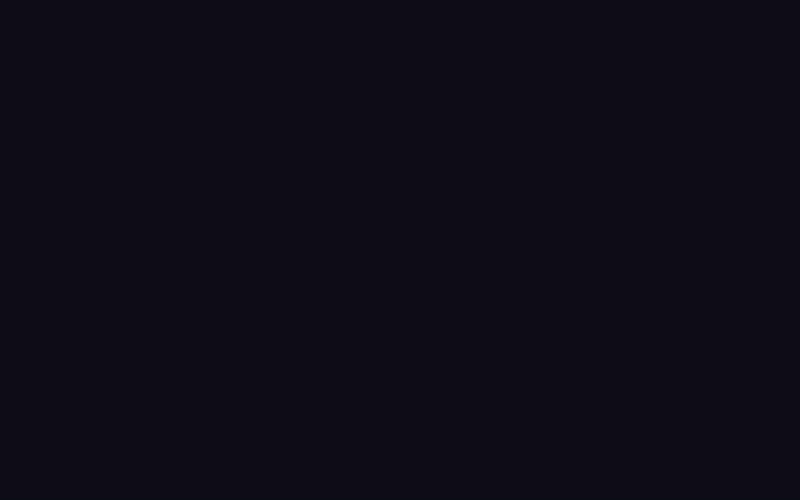
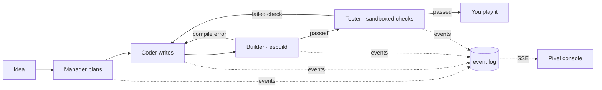

# PixelAgent Hub · Pixel AI Dev Squad

English · [中文](README.zh-CN.md)

[](https://github.com/3617375681/PIXELAGENT-HUB/actions/workflows/ci.yml)
[](https://3617375681.github.io/PIXELAGENT-HUB/)
[](pixelagent-hub/LICENSE)

**Type an idea. Watch four AI agents plan it, code it, compile it and click through it in your browser. Then play it.**

A Manager plans, a Coder writes a small offline web app, a Builder really compiles it with esbuild, and a Tester writes checks and runs them in a sandbox. Compiler errors and failed checks go straight back to the Coder. Every animation in the pixel console is a real event, never fake progress.

**▶ [Open the live demo](https://3617375681.github.io/PIXELAGENT-HUB/)**: press **BUILD LIVE** and use your own key. It runs entirely in your tab, with no server and no sign-up.



<sub>One real run, unedited apart from 1.5× speed: `deepseek-chat`, about 20 s from idea to a playable app, 10/10 Tester checks.</sub>

## Why it's different

- **Verified, not self-reported.** The app has to compile, and the Tester's checks have to pass in a real browser. The agents never just say "done". A failure becomes evidence the Coder must fix, and you can watch it travel back along the red edge.
- **Runs in your browser with your own key.** The static GitHub Pages site runs the whole loop client-side: streaming model calls, esbuild-wasm, and sandboxed checks. It uses the same prompts and bundling code as the Node server.
- **Honest numbers.** 50 recorded real-model generations ship with the repo: sources, event logs, test plans, browser reports and screenshots, failures included. The headline finding is unflattering: [a planning agent made no measurable difference](#results-you-can-check).

## PLAY LIVE: bring your own key

| Provider | Suggested model | | Provider | Suggested model |
| --- | --- | --- | --- | --- |
| DeepSeek | `deepseek-chat` | | OpenRouter | `deepseek/deepseek-chat` |
| Anthropic | `claude-opus-5-5` | | Qwen (DashScope) | `qwen-plus` |
| OpenAI | `gpt-4o-mini` | | Zhipu GLM | `glm-4-flash` |
| SiliconFlow | `deepseek-ai/DeepSeek-V3` | | | |

- **Models:** the model field is free text, so use any model your key can access.
- **Your key** is sent only to the provider you pick and kept in the tab by default. Generated apps run in an iframe with no same-origin access, so they can't read it ([SECURITY.md](pixelagent-hub/SECURITY.md)).
- **Each run:**
  1. The Manager plans.
  2. The Coder writes code; up to 3 compile rounds feed compiler errors back to it.
  3. The Tester plans independent checks.
  4. The checks run, each on a freshly loaded page.
  5. If a check fails, the Coder gets **one repair round**, and the same checks run again.
- **SHARE** a finished run: the link carries the whole run in its URL fragment (request, timeline, app and source), so anyone can replay it and play the app, with no server and no key.
- **Cost:** typically 20k–40k tokens per run. Claude runs use server-side refusal fallbacks.
- **Limitation:** in-browser checks run inside the app's own page, so a hostile app could forge them. Independent sandboxed-Chromium checks need the local server.

## When things break



The Builder hands the real esbuild error to the Coder (round 1 → round 2). A failed browser check does the same from the Tester, with the selector, the expected value and what the page actually showed.

## Results you can check

All with real models; see the [evidence index](pixelagent-hub/docs/evidence/README.md).

- **[Single vs multi-agent, repeated](pixelagent-hub/docs/software-studio/benchmark-results/2026-10-15-repeated/README.md):**
  - Design: 5 apps × 2 strategies × 3 runs with `deepseek-v4-pro`.
  - Result: Manager → Coder passed every check in 13/15 runs; Coder only in 12/15.
  - Cost: planning added about 1,200 tokens per app for no measurable gain.
  - Every failure is listed.
- **[Showcase](pixelagent-hub/docs/software-studio/benchmark-results/2026-10-18-showcase/README.md):** 6 ideas, 10 attempts. 5 ideas ended with every check passing; the pixel pet never built (3 attempts). One failure came from the Tester's plan, not the app, which led to fresh per-check isolation.
- **[Controlled fault repair](pixelagent-hub/docs/software-studio/benchmark-results/2026-10-09-real-repair-source-context/README.md):** a counter was broken to `+= 2`. The browser check caught it; the repair changed one line and left three files byte-identical.
- The write-up (in Chinese): [I had four agents split the work, ran it 30 times, and it did no better than one](pixelagent-hub/docs/articles/multi-agent-not-better.zh-CN.md).
- These are small samples, not general success rates. Browse all 40 replayable runs in the demo's gallery.

## How it works



- **Shared core** (`src/studio/shared`): agent prompts, output schemas, file validation and the HTML inliner, with no Node APIs. The Node server and the browser run the same code.
- **Server** (TypeScript + Node):
  - an isolated per-project workspace, atomically written JSON state, and an ordered `events.jsonl` streamed over SSE;
  - independent Playwright checks;
  - versions, diffs, and repair from saved evidence;
  - an OpenAPI contract that tests validate against real responses.
- **Dashboard** (React 19 + Vite): a pure reducer turns events into the four agents' state, connectors, data packets and the red feedback edge. Each stage card plays 8-bit sounds and particle effects only on real transitions. The static build adds a replay gallery and PLAY LIVE.
- **Engineering:** queueing, cancellation, timeouts, restart recovery, idempotent creation, auth and rate limits. CI runs on Node 18/20/22 and Windows, with a real browser and a Docker production start.

## Run locally

Needs Node 22.12+. The default offline mock model builds a real counter whose first attempt deliberately fails to compile, so you see the compile → repair loop without any key.

```bash
cd pixelagent-hub
cp .env.example .env          # LLM_PROVIDER=mock; set a provider + key for real generation
npm ci && npm --prefix dashboard ci
npm run build:all
npm start                     # http://127.0.0.1:3100/studio
```

- **Independent browser checks:** run `npx playwright install chromium` and set `ENABLE_STUDIO_BROWSER_CHECKS=true`.
- **Docker:** run `docker compose up --build` from the repo root.
- **Tests:** `npm test` and `npm --prefix dashboard test`.

## Limits

- Small offline HTML/CSS/JS apps and games only: no databases, logins, payments or npm dependencies.
- The Tester's checks are model-written and cover only what the plan lists; passing them is not human acceptance.
- Single process; not a distributed scheduler.

## How it was built

The starting point was a pixel-art multi-agent console prototype generated by Kimi, driven by fake data (commit `14a030e`). The backend and Studio loop were built with GPT's help. Claude Code then narrowed the scope, restored the original look, and added the event timeline, the replay, PLAY LIVE and the experiments. The author set the direction, the trade-offs and the acceptance bar, and every change goes through tests and CI.

[Contributing](pixelagent-hub/CONTRIBUTING.md) · [Security](pixelagent-hub/SECURITY.md) · [Changelog](pixelagent-hub/CHANGELOG.md) · [Framework docs](pixelagent-hub/README.md) · MIT licensed ([LICENSE](pixelagent-hub/LICENSE)).
