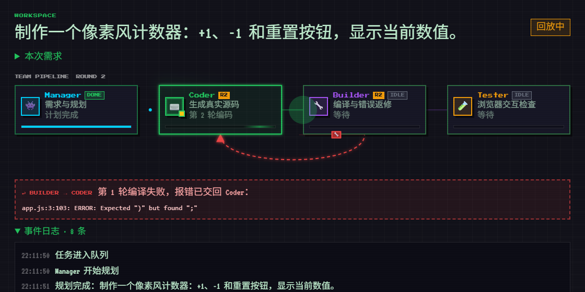
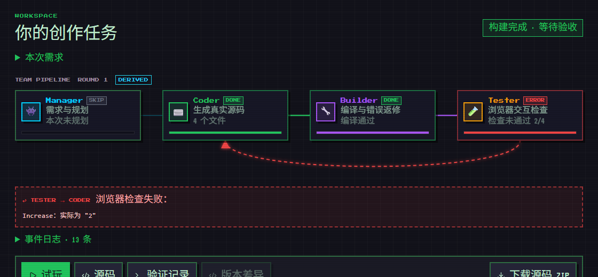
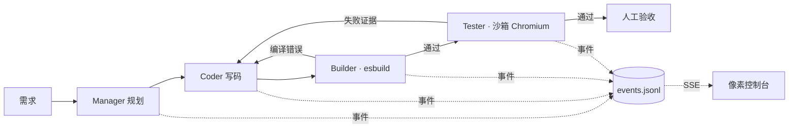

# PixelAgent Hub · 像素 AI 开发小队

[](https://github.com/3617375681/PIXELAGENT-HUB/actions/workflows/ci.yml)
[](https://github.com/3617375681/PIXELAGENT-HUB/actions/workflows/pages.yml)
[](pixelagent-hub/LICENSE)

**一句话需求 → 4 个 Agent 规划、写码、真实编译、浏览器验收；失败证据自动回到 Coder 返修。** 每一步都写进事件日志，像素风控制台里看到的每个动画都对应一条真实事件。

> A pixel-art AI dev squad: Manager plans, Coder writes an offline web app, esbuild really compiles it, Tester checks it in a sandboxed Chromium, and any compiler error or failed check is sent back to the Coder. Every animation in the console is driven by a recorded server event.

**▶ [在线回放演示](https://3617375681.github.io/PIXELAGENT-HUB/)**（只读、无需后端或密钥） · [本地运行](#本地运行) · [作品集说明](pixelagent-hub/docs/portfolio/README.md)



## 它做什么

| 阶段 | 实际发生的事 |
| --- | --- |
| **Manager** 规划 | 把需求拆成计划，交给 Coder |
| **Coder** 写码 | 生成离线 HTML/CSS/JS 项目，写入隔离工作区 |
| **Builder** 编译 | esbuild 真实构建；失败时把编译错误作为返修说明交回 Coder，最多 3 轮 |
| **Tester** 验收 | 生成声明式检查计划，在独立沙箱 Chromium 中点击、输入、断言并截图 |
| 返修 / 版本 | 浏览器失败证据可直接触发返修，生成新版本；原版本与证据保留，可对比源码 |
| 人工决定 | 构建通过、浏览器检查通过、人工批准三者分开记录，互不替代 |



## 可核对的结果

以下来自仓库中保存的真实模型（`deepseek-v4-pro`）记录，均含源码 ZIP、检查计划、浏览器报告与截图：

- **[10 次真实生成](pixelagent-hub/docs/software-studio/benchmark-results/2026-10-09/README.md)**（5 个应用 × 2 种策略）全部首次编译通过；原始浏览器检查 6 次通过、4 次失败。其中 2 次失败后来查明是构建器丢失 `defer` 脚本顺序的平台缺陷，已修复并加了真实浏览器回归测试。
- **[受控故障返修](pixelagent-hub/docs/software-studio/benchmark-results/2026-10-09-real-repair-source-context/README.md)**：把计数器改成 `+= 2` 后，浏览器检查 2/4 失败；依据失败证据返修只改了 1 行，另外 3 个文件逐字节不变，复测原计划 4/4、额外 7/7 通过。
- 这些是小样本观察，不代表通用成功率；单 Agent 与多 Agent 的系统对比仍在计划中。

## 工作原理



- **后端**：TypeScript + Node。`src/studio` 负责生成循环、构建、浏览器检查和版本，状态以原子写入的 JSON 落盘，每次状态变化追加到有序事件日志，经 SSE 推送（`GET /api/studio/projects/:id/events?stream=1`）。HTTP 契约见 [studio-api.yaml](pixelagent-hub/openapi/studio-api.yaml)，由测试用 Ajv 校验真实响应。
- **前端**：React 19 + Vite。事件经纯函数 reducer 变成 4 个角色的状态，驱动连线、数据包和红色回流边；没有任何模拟进度。
- **工程**：队列、取消与超时、进程重启后恢复、创建幂等、鉴权与限流；CI 覆盖 Node 18/20/22、Windows、真实浏览器和 Docker 生产启动。

## 本地运行

需要 Node 22.12+。默认使用离线 mock 模型：生成一个真实可编译的像素计数器，第 1 轮故意带语法错误，用来演示真实的编译 → 返修流程。

```bash
cd pixelagent-hub
cp .env.example .env          # LLM_PROVIDER=mock；真实生成改为所选模型并填写密钥
npm ci && npm --prefix dashboard ci
npm run build:all
npm start                     # http://127.0.0.1:3100/studio
```

- 想看清每一步：在 `.env` 加 `MOCK_LLM_DELAY_MS=1500`。
- 浏览器检查：`npx playwright install chromium`，并设置 `ENABLE_STUDIO_BROWSER_CHECKS=true`。
- 回放真实模型实验：`npm run portfolio:demo`；导出静态回放：`npm run replay:export -- --browser`。
- Docker：在仓库根目录 `docker compose up --build`，见 [Docker 部署说明](pixelagent-hub/docs/software-studio/docker-start.md)。
- 测试：`npm test`（后端）、`npm --prefix dashboard test`（前端）。

## 已知限制

- 生成范围限于离线 HTML/CSS/JS 小应用与小游戏，不生成数据库、登录、支付或 npm 依赖项目。
- Tester 的检查由模型生成，只覆盖计划里写到的行为；页面编译成功或检查通过都不等于人工验收。
- 用量记录 token 与耗时，不计算实际费用。
- 单进程运行，不是分布式调度平台。

## 开发方式

项目起点是 Kimi 生成的像素风多 Agent 控制台原型（假数据驱动，见提交 `14a030e`）。后端、Studio 生成与验收流程在 GPT 的协助下实现；之后用 Claude Code 收敛范围、恢复原版视觉、加入事件时间线和静态回放。作者负责方向、取舍和验收标准；所有改动都经过测试与 CI 约束。

## 更多文档

- [Software Studio 运行说明](pixelagent-hub/docs/software-studio/README.md) · [API 集成](pixelagent-hub/docs/software-studio/api-integration.md) · [同源本地启动](pixelagent-hub/docs/software-studio/local-start.md)
- [底层多 Agent 框架](pixelagent-hub/README.md)：6 种协作模式（Pipeline / Parallel / Debate / Vote / Roundtable / Company）、多模型提供商、Records API
- [贡献指南](pixelagent-hub/CONTRIBUTING.md) · [安全策略](pixelagent-hub/SECURITY.md) · [更新记录](pixelagent-hub/CHANGELOG.md)

## License

MIT — 详见 [LICENSE](pixelagent-hub/LICENSE)。
