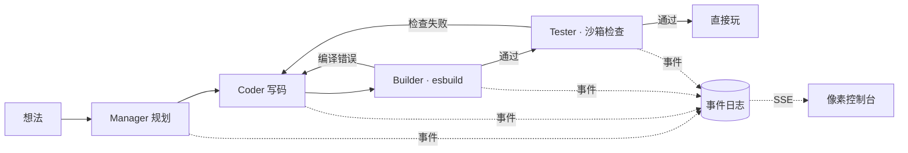

# PixelAgent Hub · 像素 AI 开发小队

[English](README.md) · 中文

[](https://github.com/Jiarong-Song233/PIXELAGENT-HUB/actions/workflows/ci.yml)
[](https://jiarong-song233.github.io/PIXELAGENT-HUB/)
[](LICENSE)

**输入一个想法，看 4 个 AI Agent 在你的浏览器里规划、写码、编译、逐项测试，然后直接玩。**

四个 Agent 各司其职：
- **Manager** 拆解需求；
- **Coder** 写一个离线小应用；
- **Builder** 用 esbuild 真实编译；
- **Tester** 写检查清单，并在沙箱里逐项执行。

编译错误和失败的检查都会直接交回 Coder 返修。像素控制台里的每一个动画都对应一条真实事件，没有任何模拟进度。

**▶ [打开在线演示](https://jiarong-song233.github.io/PIXELAGENT-HUB/)**：点 **BUILD LIVE**，填入你自己的模型 key。整个流程都在你的浏览器标签页里运行，不需要服务器，也不用注册。


<sub>一次真实运行，除了 1.5 倍速外未做剪辑：模型是 `deepseek-chat`，从想法到可玩的应用约 20 秒，Tester 检查 10/10 通过。</sub>

## 有什么不一样

- **靠验证，不靠自述。** 应用必须真的编译通过，Tester 的检查必须在真实浏览器里通过，Agent 说"完成"不算数。失败会变成证据交回 Coder，你能看到它沿着红线传回去。
- **在你的浏览器里、用你自己的 key 运行。** GitHub Pages 静态站点在本地跑完整个流程：流式调用模型、esbuild-wasm 编译、沙箱检查。它和 Node 服务器用的是同一套提示词和打包代码。
- **数字如实公开。** 仓库里附带 450 多次真实模型运行的完整记录，包括源码、事件日志、检查计划、浏览器报告和截图，失败的也在内。最重要的结论对项目本身并不讨好：[规划 Agent 没有带来可测的提升](#可核对的结果)。

## 在线生成（PLAY LIVE）：用你自己的 key

| 提供商 | 推荐模型 | | 提供商 | 推荐模型 |
| --- | --- | --- | --- | --- |
| DeepSeek | `deepseek-chat` | | OpenRouter | `deepseek/deepseek-chat` |
| Anthropic | `claude-opus-5-5` | | 通义千问（DashScope） | `qwen-plus` |
| OpenAI | `gpt-4o-mini` | | 智谱 GLM | `glm-4-flash` |
| 硅基流动 | `deepseek-ai/DeepSeek-V3` | | **自定义 / 本地** | Ollama、LM Studio、vLLM 等上的任意模型（[见下文](#本地模型)） |

- **模型**：模型名可以自由填写，你的 key 能用的任何模型都可以。
- **key 的去向**：只发给你选的提供商，默认只保存在当前标签页。生成的应用运行在没有同源权限的 iframe 里，读不到你的 key（见 [安全说明](SECURITY.md)）。
- **每次运行的流程**：
  1. Manager 规划；
  2. Coder 写码，最多 3 轮编译，编译错误会交回 Coder；
  3. Tester 写一组互相独立的检查；
  4. 每项检查都在重新加载的页面上执行；
  5. 有检查失败时，Coder 获得**一次返修机会**，然后用同一组检查复测。
- **想法链接**：`https://jiarong-song233.github.io/PIXELAGENT-HUB/#/studio?idea=…` 会打开演示页并把想法填进输入框，适合贴在帖子里让别人一键试，例如 [贪吃蛇](https://jiarong-song233.github.io/PIXELAGENT-HUB/#/studio?idea=A%20pixel%20snake%20game%3A%20arrow%20keys%20to%20move%2C%20a%20score%20and%20a%20game-over%20screen%20with%20restart.)。
- **分享**：运行结束后点 **SHARE**，整次运行（需求、事件时间线、应用和源码）都会压缩进链接的 URL 片段里。别人打开链接就能回放整个过程并直接玩这个应用，不需要服务器，也不需要 key。
- **开销**：一次运行通常消耗 2–4 万 token。用 Claude 时会开启服务端拒答兜底（refusal fallbacks）。
- **局限**：浏览器里的检查运行在被测应用自己的页面中，恶意应用理论上可以伪造结果。独立的沙箱 Chromium 检查需要本地服务器模式。

## 本地模型

PLAY LIVE 也可以连接任何 OpenAI 兼容的服务器，包括你自己电脑上的模型：不需要 key，不经过云端，也不花钱。

1. 启动服务器，并允许演示页的来源访问（CORS）：
   - **Ollama**：`OLLAMA_ORIGINS=* ollama serve`（也可以只设为 `https://jiarong-song233.github.io`）。
   - **LM Studio**：启动本地服务器并打开 CORS。
2. 在 BUILD LIVE 里选择 **Custom / local**。
3. SERVER URL 填 `http://localhost:11434/v1`（Ollama）或 `http://localhost:1234/v1`（LM Studio）。
4. 填入模型名（例如 `qwen3:4b`），key 留空。

实测参考：在一台没有独立显卡的笔记本 CPU 上（约 14 token/秒），`qwen3:4b` 用 22 分钟做出了一个计数器，3/3 检查通过。用 GPU 或云端模型会快得多。本地服务器的每个 Agent 最多有 20 分钟，随时可以点 STOP 停止。只有 `localhost` 允许用 `http://`，其他地址必须是 `https://`。有些浏览器会先询问是否允许网页访问本地服务器。

## 出错时会发生什么


Builder 会把真实的 esbuild 报错交给 Coder（第 1 轮 → 第 2 轮）。浏览器检查失败时，Tester 也会做同样的事，并附上选择器、期望值和页面上的实际内容。

## 可核对的结果

以下都来自真实模型，详见 [证据索引](pixelagent-hub/docs/evidence/README.md)。

- **[单 Agent vs 多 Agent 重复对比](pixelagent-hub/docs/software-studio/benchmark-results/2026-10-15-repeated/README.md)**
  - 实验：5 个应用 × 2 种策略 × 3 次，模型为 `deepseek-v4-pro`。
  - 结果：先规划再写码 13/15 完整通过，直接写码 12/15。
  - 代价：规划平均每个应用多花约 1,200 token，没有可测的收益。
  - 每一次失败都逐条列出。
- **[PLAY LIVE 基准](pixelagent-hub/docs/software-studio/benchmark-results/2026-10-18-live/README.md)**：5 个固定用例 × 3 次，在真实的静态站点里用 `deepseek-chat` 运行。修正 Tester 提示后，完整通过从 8/15 提高到 **11/15**，再加上空白字符修正后为 **14/15**。每一次失败都来自 Tester 写的检查计划（算错、没设下拉框、跳过步骤、计划格式不合法），而不是应用本身。因此现在 Tester 会在归咎 Coder 之前先复查失败的检查。在 6 个更难的想法（贪吃蛇、番茄钟、宠物等）上，修好这一轮暴露的问题后，完整通过从 7/18 提高到 **11/18**，也不再出现运行崩溃或没有检查就交付的情况（原来有 4 次）。之后又经过两轮，提高到 **17/18**：检查语言新增了“数元素个数”和“读属性值”，`visible` 也改成把透明的遮罩层当作隐藏，和人眼看到的一致。几乎每一次提升都来自修正检查本身，而不是应用。2026-10-20 的复测中，5 个固定用例首次达到 [15/15](pixelagent-hub/docs/software-studio/benchmark-results/2026-10-20-live/README.md)。
- **[留出想法测试](pixelagent-hub/docs/software-studio/benchmark-results/2026-10-21-holdout/README.md)**：为了确认调优没有过拟合，每一轮还会在 8 个全新想法上评分。这些想法在运行前就已提交，也从不用来做修正。在这些干净的集合上，严格通过（全部检查通过且没有丢弃检查）三轮依次为 **10/16 → 12/16 → 14/16**；5 个固定用例已连续五轮 15/15。剩下的失败里，有一些是检查抓到的真实应用 bug，比如小费平分时把 $27.775 舍成了 $27.77。
- **[真实模型展示](pixelagent-hub/docs/software-studio/benchmark-results/2026-10-18-showcase/README.md)**：6 个想法共 10 次尝试，其中 5 个最终全部检查通过；像素宠物 3 次都没能生成出来。有一次失败的原因是 Tester 写错了计划，而不是应用本身有问题，这促成了"每项检查重新加载页面"的改进。
- **[受控故障返修](pixelagent-hub/docs/software-studio/benchmark-results/2026-10-09-real-repair-source-context/README.md)**：把计数器故意改成 `+= 2`，浏览器检查发现了这个故障；返修只改了 1 行，另外 3 个文件逐字节不变。
- 完整复盘：[我让 4 个 AI Agent 分工写代码，测了 30 次，结果并不比 1 个强](pixelagent-hub/docs/articles/multi-agent-not-better.zh-CN.md)。
- 这些都是小样本观察，不代表通用成功率。在线演示的画廊里可以回放其中 40 次。

## 工作原理



- **共享核心**（`src/studio/shared`）：提示词、输出校验、文件校验、HTML 打包，不依赖任何 Node API。服务器和浏览器运行的是同一份代码。
- **服务器**（TypeScript + Node）：
  - 每个项目一个隔离工作区，状态以原子写入的 JSON 保存，每次状态变化追加到有序的 `events.jsonl`，并通过 SSE 推送；
  - 用 Playwright 独立执行检查；
  - 支持版本、源码对比，以及根据保存的证据返修；
  - HTTP 契约由测试用真实响应校验。
- **前端**（React 19 + Vite）：一个纯函数 reducer 把事件变成 4 个角色的状态、连线、数据包和红色回流边；8-bit 音效和粒子特效只在真实的状态变化时触发。静态构建额外提供回放画廊和 PLAY LIVE。
- **工程**：队列、取消、超时、重启后恢复、幂等创建、鉴权与限流。CI 覆盖 Node 18/20/22、Windows、真实浏览器和 Docker 生产启动。

## 本地运行

需要 Node 22.12+。默认使用离线 mock 模型，它会生成一个真实可编译的计数器，第 1 轮故意带语法错误，所以不需要任何 key 也能看到"编译 → 返修"的完整流程。

```bash
cd pixelagent-hub
cp .env.example .env          # 默认 LLM_PROVIDER=mock；真实生成时改为所选模型并填写 key
npm ci && npm --prefix dashboard ci
npm run build:all
npm start                     # http://127.0.0.1:3100/studio
```

- **独立浏览器检查**：先运行 `npx playwright install chromium`，再设置 `ENABLE_STUDIO_BROWSER_CHECKS=true`。
- **Docker**：在仓库根目录运行 `docker compose up --build`。
- **测试**：`npm test`（后端）和 `npm --prefix dashboard test`（前端）。

## 已知限制

- 只生成离线的 HTML/CSS/JS 小应用和小游戏，不涉及数据库、登录、支付或 npm 依赖。
- Tester 的检查由模型生成，只覆盖计划里写到的行为；检查通过不等于人工验收。
- 单进程运行，不是分布式调度平台。

## 开发方式

项目的起点是 Kimi 生成的像素风多 Agent 控制台原型，当时由假数据驱动（提交 `14a030e`）。后端和 Studio 生成流程在 GPT 的协助下实现。之后用 Claude Code 收敛了范围、恢复了原版视觉，并加入了事件时间线、静态回放、PLAY LIVE 和各项实验。作者负责方向、取舍和验收标准，所有改动都经过测试与 CI。

[贡献指南](CONTRIBUTING.md) · [安全策略](SECURITY.md) · [更新记录](pixelagent-hub/CHANGELOG.md) · [底层框架文档](pixelagent-hub/README.md) · MIT 许可（[LICENSE](LICENSE)）。
